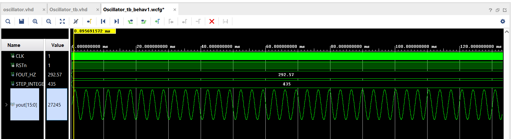
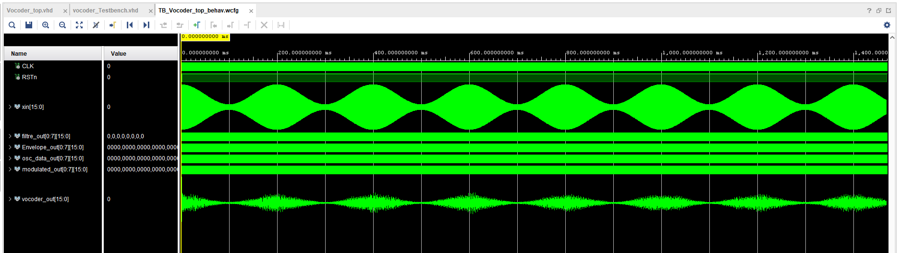

# Channel Vocoder in VHDL

> A digital **channel vocoder** designed from scratch in VHDL: an oscillator generates a synthetic carrier, a bank of IIR band-pass filters splits the signal into frequency bands, and envelope detectors extract how loud each band is, so a voice can "speak through" a synthetic sound.


---

## Table of Contents

- [What is this project?](#-what-is-this-project)
- [What is a vocoder?](#-what-is-a-vocoder)
- [What I did](#-what-i-did)
- [System architecture](#-system-architecture)
- [Module 1: Oscillator](#-module-1-oscillator-carrier-generator)
- [Module 2: Band-pass filter](#-module-2-iir-band-pass-filter)
- [Module 3: Envelope detector](#-module-3-envelope-detector)
- [Putting it all together](#-putting-it-all-together)
- [Repository structure](#-repository-structure)
- [How to run the simulations](#-how-to-run-the-simulations)
- [Results & conclusion](#-results--conclusion)
- [Future work](#-future-work)
- [Author](#-author)

---

## What is this project?

This project is a **hardware implementation of a vocoder** written in **VHDL**. The goal is to design, simulate and verify every building block of a channel vocoder at the digital-logic level, so that it can later run on an FPGA for real-time audio effects.

Instead of using ready-made DSP libraries, every block (oscillator, filters, envelope detector) is described in VHDL and tested with its own **testbench**.

---

## What is a vocoder?

A vocoder takes two signals:

| Signal | Role | Example |
|--------|------|---------|
| **Modulator** | Provides the *shape* of the sound (what is being said) | A human voice |
| **Carrier** | Provides the *sound* (the pitch and timbre) | A synthesizer / oscillator |

It measures how the energy of the modulator is distributed across frequency bands, then forces the carrier to follow that distribution. The result is a voice that sounds robotic or "sung" by a synthesizer. It is the classic effect used in electronic music.

---

## What I did

1. **Studied the vocoder principle** and chose the *channel vocoder* architecture (analysis filter bank → envelope extraction → synthesis filter bank).
2. **Designed the carrier source:** a digital **oscillator** in VHDL that produces the synthetic signal.
3. **Designed the filter bank cell:** a **second-order IIR (biquad) band-pass filter** in VHDL, chosen because it reaches sharp frequency selectivity with very few coefficients.
4. **Designed the envelope detector:** a **rectifier + low-pass filter** that tracks the amplitude of each band.
5. **Wrote a testbench for every module** and checked its behaviour in simulation, waveform by waveform.
6. **Integrated the blocks** in a top-level design (`Vocoder_Top`) following the channel vocoder block diagram.

<!-- TODO: add any extra steps you did (coefficient calculation in MATLAB/Python, fixed-point conversion, FPGA synthesis, etc.) -->

---

## System architecture


**Signal flow:**

```
Voice ──► [Band-pass filters] ──► [Envelope detectors] ──┐
                                                         ▼
Oscillator ──► [Band-pass filters] ──────────────────► [ × ] ──► [ Σ ] ──► Vocoded output
```

1. The **voice** is split into frequency bands by the analysis band-pass filters.
2. Each band goes through an **envelope detector** that outputs its slowly varying amplitude.
3. The **oscillator** signal goes through an identical filter bank (synthesis).
4. Each carrier band is **multiplied** by the envelope of the matching voice band.
5. All bands are **summed** to build the output.

| Parameter | Value |
|-----------|-------|
| Language | VHDL |
| Filter type | IIR band-pass, biquad (2nd order) |
| Number of channels | `TODO` |
| Sampling frequency | `TODO` |
| Data width | `TODO` |

---

## Module 1: Oscillator (carrier generator)

**Role:** produces the synthetic carrier signal. Its frequency decides the **pitch** of the final vocoded voice.


- Design: [`Oscillator.vhd`](Vocoder_Top/Oscillator/Oscillator.vhd)
- Testbench: [`Testbensh_Oscillator.vhd`](Vocoder_Top/Oscillator/Testbensh_Oscillator.vhd)

### Simulation waveform



**What the waveform shows:** the oscillator output after reset is released. The signal is periodic with a constant amplitude and a stable frequency of `TODO` Hz, which is exactly what the carrier needs: a clean, steady source rich enough for the filters to shape.

---

## Module 2: IIR band-pass filter

**Role:** the core of the vocoder. One band-pass filter lets only one slice of the spectrum through. Several of them with different centre frequencies form the **filter bank** that analyzes the voice and shapes the carrier.

### Structure


### Biquad implementation


Each filter implements the second-order difference equation:

```
y[n] = b0·x[n] + b1·x[n-1] + b2·x[n-2] − a1·y[n-1] − a2·y[n-2]
```

where `b0, b1, b2` are the feed-forward coefficients and `a1, a2` the feedback coefficients that set the centre frequency and bandwidth.

- Design: [`Filter.vhd`](Vocoder_Top/Band_Pass%20Filtre/Filter.vhd)
- Testbench: [`Filter_tb.vhd`](Vocoder_Top/Band_Pass%20Filtre/Filter_tb.vhd)

### Simulation waveforms

**Test 1:**


**Test 2:**


**What the waveforms show:** the filter was tested with input signals at different frequencies. When the input frequency is **inside the pass-band** (around the centre frequency of `TODO` Hz), the output follows the input with a strong amplitude. When the input is **outside the pass-band**, the output is strongly attenuated. This confirms the filter is stable and selects the intended frequency band.

---

## Module 3: Envelope detector

**Role:** an audio band oscillates thousands of times per second, but what the vocoder needs is only **how strong that band is over time**. The envelope detector rectifies the band signal and smooths it with a **low-pass filter**, leaving a slow curve that follows the band's amplitude.

-  Design: [`Enveloppe.vhd`](Vocoder_Top/Enveloppe-Low_Pass%20Filtre/Enveloppe.vhd)
-  Testbench: [`Enveloppe_tb.vhd`](Vocoder_Top/Enveloppe-Low_Pass%20Filtre/Enveloppe_tb.vhd)

### Simulation waveform


**What the waveform shows:** the fast oscillating input is converted into a smooth output that rises and falls with the amplitude of the input. The high-frequency content is removed, and only the amplitude information remains, which is what controls the carrier in the synthesis stage.

---

## 🔗 Putting it all together

Once each block was validated alone, they were combined following the channel vocoder diagram:

| Stage | Block used | Purpose |
|-------|-----------|---------|
| Carrier source | Oscillator | Generates the synthetic sound |
| Analysis | Band-pass filter bank | Splits the voice into frequency bands |
| Envelope | Rectifier + low-pass filter | Measures the energy of each band |
| Synthesis | Band-pass filter bank | Splits the carrier into the same bands |
| Modulation | Multiplier | Applies voice energy to each carrier band |
| Output | Adder | Sums all bands into the vocoded signal |


--

---

## Repository structure

```
Vocoder-Implementation/
├── Channel_Vocoder.png                  # Full vocoder block diagram
├── Filter_IIR.png                       # IIR filter overview
├── Oscillator.png                       # Oscillator overview
└── Vocoder_Top/
    ├── Band_Pass Filtre/
    │   ├── Filter.vhd                   # IIR biquad band-pass filter
    │   ├── Filter_tb.vhd                # Filter testbench
    │   ├── Filter_IIR_Structure.png     # Filter structure
    │   ├── Filter_IIR_Biquad.png        # Biquad diagram
    │   ├── Band-pass_Test.png           # Simulation result 1
    │   └── Band-pass_Test2.png          # Simulation result 2
    ├── Enveloppe-Low_Pass Filtre/
    │   ├── Enveloppe.vhd                # Envelope detector
    │   ├── Enveloppe_tb.vhd             # Envelope testbench
    │   └── Enveloppe_Test.png           # Simulation result
    └── Oscillator/
        ├── Oscillator.vhd               # Carrier oscillator
        ├── Testbensh_Oscillator.vhd     # Oscillator testbench
        ├── Oscillator.png               # Oscillator diagram
        └── Oscillator_Test.png          # Simulation result
```

---

## Results & conclusion

- The **oscillator** produces a stable periodic carrier.
- The **IIR band-pass filter** passes in-band frequencies and rejects out-of-band ones.
- The **envelope detector** turns fast audio into a smooth amplitude curve.
- Every block is verified individually with its own testbench, and together they form the complete channel vocoder chain.

This project gave hands-on experience with **digital filter design, VHDL modelling, testbench-based verification, and hardware-oriented DSP**.

---
