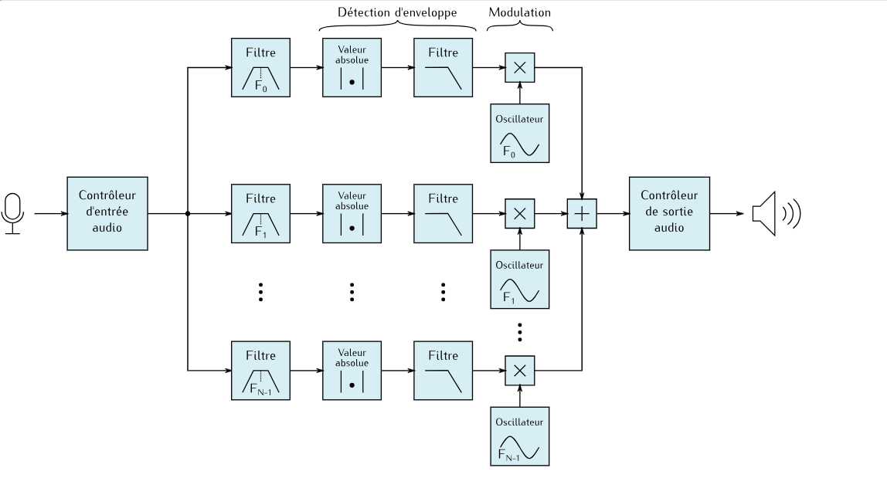
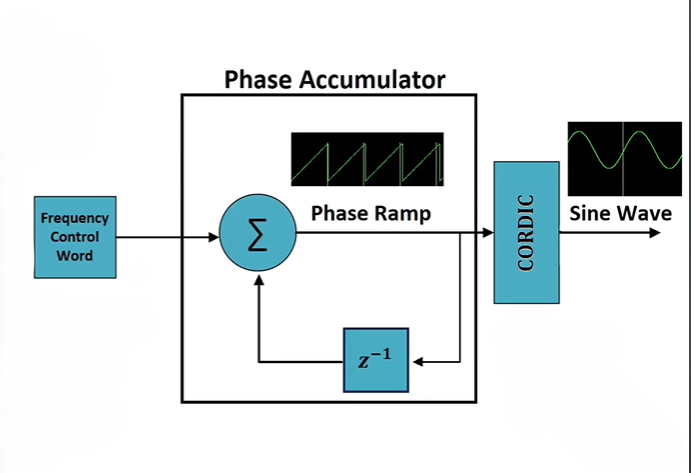
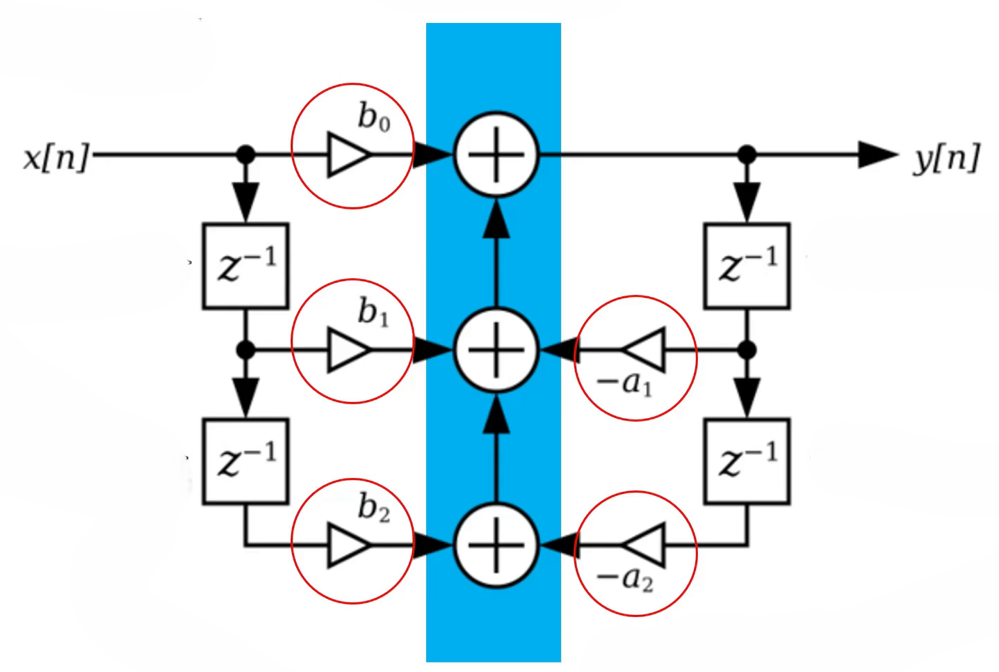

# 🎙️ Vocoder Implementation

A **channel vocoder** implementation built from modular blocks: an oscillator (carrier source), an IIR filter bank, and a top-level module that ties them together to synthesize robotic / "talking instrument" voice effects.



---

## 📖 Table of Contents

- [Overview](#-overview)
- [How a Vocoder Works](#-how-a-vocoder-works)
- [System Architecture](#-system-architecture)
- [Key Components](#-key-components)
  - [Oscillator](#1-oscillator)
  - [IIR Filter](#2-iir-filter)
  - [Top-Level Module](#3-top-level-module)
- [Repository Structure](#-repository-structure)
- [Getting Started](#-getting-started)
- [Usage](#-usage)
- [Simulation & Results](#-simulation--results)
- [Tools & Technologies](#-tools--technologies)
- [Future Improvements](#-future-improvements)
- [Contributing](#-contributing)
- [License](#-license)
- [Author](#-author)

---

## 🔍 Overview

A **vocoder** (voice encoder) analyzes the spectral characteristics of a speech signal (the *modulator*) and imposes them on another sound (the *carrier*), such as a synthesizer or oscillator. The result is the classic "robot voice" heard in music and sound design.

This project implements a **channel vocoder** in which:

- The input speech is split into several frequency bands by a bank of **IIR band-pass filters**.
- The **envelope** of each band is extracted.
- Those envelopes control the amplitude of the same bands of a **carrier signal** generated by an **oscillator**.
- The processed bands are summed to produce the final output.

<!-- TODO: add your project context (course, lab, FPGA board, etc.) and target platform -->

---

## 🧠 How a Vocoder Works

1. **Analysis**: The modulator (voice) is passed through N band-pass filters. Each band captures part of the voice's spectrum.
2. **Envelope detection**: Each band is rectified and low-pass filtered to get its amplitude envelope over time.
3. **Synthesis**: The carrier (oscillator output) is passed through a matching bank of band-pass filters.
4. **Modulation**: Each carrier band is multiplied by the matching voice envelope.
5. **Mixing**: All the bands are summed into one output signal.

---

## 🏗️ System Architecture

The block diagram below shows the full channel vocoder pipeline:


<!-- TODO: describe the number of channels, sampling rate, and bit-width actually used -->

| Parameter            | Value            |
|----------------------|------------------|
| Number of channels   | `TODO`           |
| Sampling frequency   | `TODO`           |
| Data width           | `TODO`           |
| Filter type          | IIR band-pass    |
| Carrier source       | Oscillator       |

---

## 🧩 Key Components

### 1. Oscillator

The oscillator generates the **carrier signal** that gets shaped by the voice's spectral envelope. Its frequency sets the pitch of the vocoded output.



<!-- TODO: specify waveform type (sine / sawtooth / square), generation method (LUT, CORDIC, recursive, etc.) and frequency resolution -->

### 2. IIR Filter

The **Infinite Impulse Response (IIR)** filters form the analysis and synthesis filter banks. IIR filters reach sharp band selectivity with fewer coefficients than FIR filters, which keeps the design efficient.



General difference equation:

```
y[n] = b0·x[n] + b1·x[n-1] + b2·x[n-2] − a1·y[n-1] − a2·y[n-2]
```

<!-- TODO: state the structure used (Direct Form I/II, transposed, biquad cascade), and fixed-point vs. floating-point -->

### 3. Top-Level Module

`Vocoder_Top` instantiates and connects all components: the filter banks, the envelope detectors, the oscillator, and the output mixer.

---

## 📁 Repository Structure

```
Vocoder-Implementation/
├── Vocoder_Top/          # Top-level vocoder design and its sub-modules
├── Channel_Vocoder.png   # Overall channel vocoder block diagram
├── Filter_IIR.png        # IIR filter architecture
├── Oscillator.png        # Oscillator architecture
└── README.md
```

<!-- TODO: expand Vocoder_Top with the real file names -->

---

## 🚀 Getting Started

### Prerequisites

<!-- TODO: replace with your actual toolchain -->
- A simulator / synthesis tool (e.g., ModelSim, Vivado, Quartus, or Icarus Verilog)
- Git

### Installation

```bash
git clone https://github.com/Youssef-Fd/Vocoder-Implementation.git
cd Vocoder-Implementation
```

---

## ▶️ Usage

<!-- TODO: replace with real commands -->

1. Open the project in your simulation/synthesis tool.
2. Set `Vocoder_Top` as the top-level module.
3. Provide the input signals (voice/modulator and the oscillator frequency control).
4. Run the simulation and inspect the output waveform.

---

## 📊 Simulation & Results

<!-- TODO: add waveform screenshots, e.g.

-->

Expected behavior:

- The output keeps the **pitch** of the oscillator.
- The output carries the **intelligibility** of the input voice.

---

## 🛠️ Tools & Technologies

- **Digital Signal Processing**: IIR filters, envelope detection, oscillators
- **Language**: `TODO` (VHDL / Verilog / SystemVerilog / Python / MATLAB)
- **Tools**: `TODO`

---

## 🔮 Future Improvements

- Increase the number of frequency channels for better intelligibility
- Add real-time audio input/output (e.g., I2S codec)
- Add noise/sibilance handling for consonants
- Make carrier waveform and pitch selectable at runtime
- Add automated testbenches and a regression suite

---
